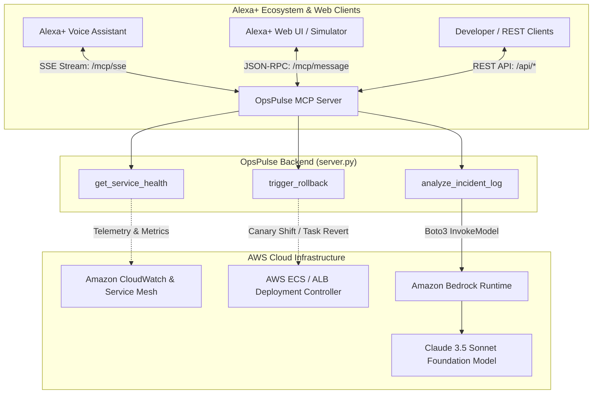

# OpsPulse for Alexa+ (MCP Server Backend)

[](https://opensource.org/licenses/Apache-2.0)
[](https://modelcontextprotocol.io/)
[](https://aws.amazon.com/bedrock/)
[](https://www.python.org/)

**OpsPulse for Alexa+** is a production-grade, self-hosted **Model Context Protocol (MCP)** server engineered for the Alexa+ Hackathon. It empowers Alexa+ to act as an automated Principal Site Reliability Engineering (SRE) copilot capable of inspecting real-time microservice fleet health, diagnosing log traces using **Amazon Bedrock Claude 3.5 Sonnet**, and triggering canary rollbacks across cloud infrastructure.

---

## 🏆 Hackathon Alignment

| Challenge / Track | Implementation Details |
| :--- | :--- |
| **Alexa+ Track** | Self-hosted MCP server running over **Streamable HTTP / Server-Sent Events (SSE)** (protocol spec 2025-11-25) at `/mcp/sse` and message receiver at `/mcp/message`. Supports seamless integration with Alexa+ skills and interactive developer web UIs. |
| **AWS Builder Mini-Challenge** | Native code-level integration with **Amazon Bedrock** (`anthropic.claude-3-5-sonnet-20240620-v1:0` via `boto3`) for intelligent incident root-cause analysis and automated SRE remediation playbooks, with resilient mock fallback handling. |
| **Open Source Mini-Challenge** | Clean, self-contained architecture in `server.py` with strict Pydantic v2 schemas, CORS middleware, extensive docstrings, and a zero-configuration test harness. |

---

## 📐 System Architecture



---

## 🛠️ MCP Domain Tools

OpsPulse exposes three high-value SRE domain tools via the Model Context Protocol:

### 1. `get_service_health(service_name: str)`
- **Purpose**: Inspects real-time operational telemetry for a microservice.
- **Metrics Inspected**: 99th percentile latency (`latency_p99_ms`), median latency (`latency_p50_ms`), CPU utilization (`cpu_utilization_pct`), memory utilization (`memory_utilization_pct`), error rate percentage (`error_rate_pct`), active task replicas, and ALB target group health distribution.
- **Example Services**: `payment-gateway` (simulated degraded), `auth-service` (healthy), `order-api` (healthy), `inventory-service` (degraded). Dynamically synthesizes consistent metrics for any arbitrary service query.

### 2. `trigger_rollback(service_name: str, target_version: str, reason: str = ...)`
- **Purpose**: Executes an emergency canary rollback for an unstable microservice.
- **Execution Workflow**:
  1. Shifts ALB weighted routing away from canary replicas (10% $\to$ 0%).
  2. Updates AWS ECS task definition revision to stable target (`target_version`).
  3. Gracefully drains connections and terminates degraded canary tasks.
  4. Runs synthetic verification healthcheck probes against the target revision.
  5. Emits an audit event to AWS EventBridge (`OpsPulseAuditBus`).

### 3. `analyze_incident_log(log_trace: str, service_name: str = ...)`
- **Purpose**: Directly invokes **Amazon Bedrock** (`anthropic.claude-3-5-sonnet-20240620-v1:0` via `boto3`) to diagnose stack traces and formulate an immediate remediation playbook.
- **Output**: Severity classification (`SEV-1` through `SEV-4`), technical root cause summary, user impact assessment, actionable numbered playbook, and primary recommended action.
- **Resilient Fallback**: If AWS credentials are not yet configured in local environment variables, automatically falls back to an intelligent local SRE diagnostics engine with zero downtime or runtime exceptions.

---

## 🚀 Getting Started

### 1. Prerequisites
- Python 3.10 or later
- (Optional) AWS account with Amazon Bedrock model access to Claude 3.5 Sonnet

### 2. Installation

Clone or open the repository directory:
```powershell
cd c:\Users\ASUS\Desktop\opspulse-alexa-mcp
```

Create and activate a virtual environment:
```powershell
python -m venv .venv
.\.venv\Scripts\Activate.ps1
```

Install production dependencies:
```powershell
pip install -r requirements.txt
```

### 3. Environment Configuration (Optional for Live Bedrock)

Copy `.env.example` to `.env`:
```powershell
cp .env.example .env
```

Configure your AWS credentials if testing against live Amazon Bedrock:
```env
AWS_REGION=us-east-1
AWS_ACCESS_KEY_ID=your-aws-access-key-id
AWS_SECRET_ACCESS_KEY=your-aws-secret-access-key
BEDROCK_MODEL_ID=anthropic.claude-3-5-sonnet-20240620-v1:0
```
> **Note**: If AWS credentials are not provided, OpsPulse operates smoothly in high-fidelity mock fallback mode, making local evaluation effortless!

### 4. Running the Server

Start the server using `server.py` directly or via `uvicorn`:
```powershell
python server.py
```
*Or with uvicorn:*
```powershell
uvicorn server:app --host 0.0.0.0 --port 8000 --reload
```

---

## 🧪 Testing & Verification

### Option A: Automated Test Suite (Fastest)
Run the bundled verification client to test all REST and MCP protocol paths:
```powershell
python test_client.py
```

---

### Option B: Interactive Swagger UI
Open your browser to:
[http://localhost:8000/docs](http://localhost:8000/docs)

All tools and endpoints can be tested interactively with pre-filled schemas.

---

### Option C: Testing with `curl`

#### 1. Liveness & Health Probe
```bash
curl http://localhost:8000/health
```

#### 2. Query Microservice Telemetry
```bash
curl http://localhost:8000/api/health/payment-gateway
```

#### 3. Trigger Canary Rollback
```bash
curl -X POST http://localhost:8000/api/rollback \
  -H "Content-Type: application/json" \
  -d '{
    "service_name": "payment-gateway",
    "target_version": "v2.4.1",
    "reason": "Automated canary rollback triggered via Alexa+"
  }'
```

#### 4. Analyze Incident Log (Amazon Bedrock)
```bash
curl -X POST http://localhost:8000/api/analyze-log \
  -H "Content-Type: application/json" \
  -d '{
    "service_name": "payment-gateway",
    "log_trace": "HTTP 504 Gateway Timeout: HikariPool-1 - Connection is not available, request timed out after 30000ms at com.zaxxer.hikari.pool.HikariPool.getConnection"
  }'
```

---

### Option D: Testing MCP Protocol (SSE + JSON-RPC)

#### 1. Establish Server-Sent Events (SSE) Stream
```bash
curl -N http://localhost:8000/mcp/sse
```
*Expected stream output:*
```
event: endpoint
data: /mcp/message?sessionId=f4a7c1b829...
```

#### 2. List Available MCP Tools via JSON-RPC
```bash
curl -X POST "http://localhost:8000/mcp/message" \
  -H "Content-Type: application/json" \
  -d '{
    "jsonrpc": "2.0",
    "id": 1,
    "method": "tools/list",
    "params": {}
  }'
```

#### 3. Invoke MCP Tool via JSON-RPC
```bash
curl -X POST "http://localhost:8000/mcp/message" \
  -H "Content-Type: application/json" \
  -d '{
    "jsonrpc": "2.0",
    "id": 2,
    "method": "tools/call",
    "params": {
      "name": "get_service_health",
      "arguments": {
        "service_name": "payment-gateway"
      }
    }
  }'
```

---

## 🔒 Security & Production Best Practices
- **Strict Typing**: Fully typed with Pydantic v2 data models for input validation.
- **Defensive AWS Boundaries**: Boto3 calls are non-blocking (delegated to thread executors) and wrapped in try/except blocks handling `NoCredentialsError`, `ClientError`, and network timeouts.
- **CORS Configured**: Allows cross-origin streaming for Alexa+ web simulators on `localhost:3000` or local file previews.
- **Specification Compliance**: Follows the MCP Streamable HTTP / SSE 2025-11-25 standard.
